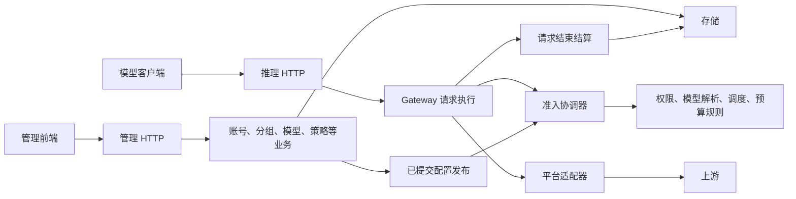

# 项目结构设计 v1

日期：2026-11-01。状态：**M1/M2 已完成，M3 前七批已落地，后续批次及 M4–M7 待实施**。

本文描述目标结构及实施进度。Go 工程已整体迁入 `backend/`，入口为 `backend/cmd/panel`，现有业务包和嵌入页面位于 `backend/internal/`。Vue 前端、业务模块拆分、公共提示词继承和多实例运行属于后续阶段。当前功能说明继续以仓库 README 和使用文档为准。

已建立 `AGENTS.md` 和 `deploy/` 补充示例；当前未创建独立 `frontend/`。迁移前基线为 `74a2a9a`，标签 `baseline/pre-structure-20261101`，见 [基线记录](../acceptance/STRUCTURE-BASELINE-2026-11-01.md)。

工程布局、产物与本机更新结果见 [M2 验收](../acceptance/STRUCTURE-M2-2026-11-01.md)。中立账号与依赖装配见 [M3 第一批验收](../acceptance/STRUCTURE-M3-1-2026-11-01.md)。

CodeArts 对话适配包装、普通单次执行与协议聚合见 [M3 第二批验收](../acceptance/STRUCTURE-M3-2-2026-11-01.md)。这两批尚未完成整个 HTTP/业务分离。

WorkBuddy/Trae 单次执行与聚合分离见 [M3 第三批验收](../acceptance/STRUCTURE-M3-3-2026-11-01.md)。三平台已共享单次执行边界，全局请求编排和管理业务仍待分离。

提示词恢复和摘要准备分离见 [M3 第四批验收](../acceptance/STRUCTURE-M3-4-2026-11-01.md)。恢复编排归 gateway，纯摘要准备归 requestpolicy；全局换号、摘要执行、凭据和管理业务继续分批迁移。

摘要执行与完整性分离见 [M3 第五批验收](../acceptance/STRUCTURE-M3-5-2026-11-01.md)。gateway 持有私有缓冲及有限截断重试；备用型号权限、计量和冷却通过 server hook 保留原入口。

全局换号和短恢复分离见 [M3 第六批验收](../acceptance/STRUCTURE-M3-6-2026-11-01.md)。gateway 持有重试/取消/租约循环，server 保留原子准入、权限预算和平台错误策略；凭据与管理业务仍待分离。

WorkBuddy/Trae 凭据协调分离见 [M3 第七批验收](../acceptance/STRUCTURE-M3-7-2026-11-01.md)。accounts 持有按账号的解析/刷新互斥，平台执行原生刷新，Store 保留条件提交；CodeArts 沿用现有 Manager。

## 设计决策

采用一个仓库、一个 Go 模块、独立前端工程、单进程部署的模块化单体。按业务能力划分代码，通过本地函数和少量接口协作。首先支持更多平台、模型和管理功能；多用户权限和多实例运行作为明确的后续扩展，不在目录迁移中顺带实现。

开发时前端与后端分别运行；发布时把前端静态产物嵌入 Go 二进制。管理 API 和推理 API 共用进程，拥有独立的鉴权入口。账号、配置、凭据和用量保存在外部运行目录。

这次设计的交付物：

| 文档 | 解决的问题 |
| --- | --- |
| [模块与依赖](MODULES.md) | 数据归属、包依赖、平台扩展、旧代码迁移位置 |
| [请求与状态](RUNTIME.md) | 模型映射、提示词、并发原子性、刷新、重试、用量与恢复 |
| [工程与部署](ENGINEERING.md) | 前端、API 契约、构建、部署、CI、AGENTS 与 skills |
| [迁移与验收](MIGRATION.md) | 分阶段实施、进入条件、行为验证、性能门槛、回退 |
| [ADR 0007](../adr/0007-modular-monolith.md) | 本次取舍及与历史 ADR 的关系 |

## 当前结构的依据

以下来自本次工作区静态检查，并非正在运行的服务或生产部署状态：

- [Server](../../backend/internal/server/server.go) 同时持有 HTTP、CodeArts 客户端、通用平台注册表、登录和任务运行状态。
- [Store](../../backend/internal/store/store.go) 同时管理持久化、调度和预算；[选号入口](../../backend/internal/store/pool.go) 已在同一临界区复核权限、选择实际型号和占用账号并发。
- 通用账号已迁入 [accounts](../../backend/internal/accounts/account.go)，账号类型本身仅依赖标准库；凭据协调只依赖中立 provider 契约。旧 `session` 字段通过不透明只读接口保留，由 [兼容编码器](../../backend/internal/store/account_codec.go) 在加载状态时还原 CodeArts 会话，保持 schema 6 和代际指针。
- [app.Build](../../backend/internal/app/app.go) 创建平台客户端、注册 WorkBuddy/Trae 并连接刷新提交回调；Server 接收明确依赖，不再负责创建和注册平台客户端。进程生命周期暂留在 main。
- [gateway.Completions](../../backend/internal/gateway/completions.go) 执行已授权、已选号的单次 CodeArts 对话，借助 [CodeArts 适配包装](../../backend/internal/upstream/codearts/adapter.go) 调用既有签名客户端；普通流式即时回调，非流式保留原空响应回退。摘要由 gateway 执行，备用型号权限和平台错误策略仍在 server，准入仍在 Store。
- WorkBuddy/Trae 经 [upstream.BindStream](../../backend/internal/upstream/stream.go) 绑定已解析凭据及请求标识，同样调用 `gateway.Completions`；各自原生适配器不变。非流式仍由流式聚合，维持 32MiB 上限；凭据刷新经 [accounts.ProviderCredentials](../../backend/internal/accounts/provider_credentials.go) 协调，沿用原生适配器和 Store 条件提交；提示词恢复由 gateway 执行，server 提供原计量及权限/预算 hook。
- [gateway.RunPromptPolicy](../../backend/internal/gateway/prompt_policy.go) 负责有限的提示词恢复；[摘要准备](../../backend/internal/requestpolicy/summary.go) 保留原识别规则和请求参数。[gateway.RunSummary](../../backend/internal/gateway/summary.go) 持有完整性缓冲和有限截断重试；[gateway.RunAccountRetry](../../backend/internal/gateway/retry.go) 负责全局换号及租约生命周期，[RunRecovery](../../backend/internal/gateway/recovery.go) 负责同租约有限恢复；平台判定、权限预算、原子准入和账本保留原入口。
- [平台接口](../../backend/internal/provider/provider.go) 已存在；搜索、奖励、成长任务采用可选能力接口，可以继续利用。
- [协议转换](../../backend/internal/protocol/anthropic.go)、[Responses 兼容](../../backend/internal/responsescompat/chatcompletions_responses_bridge.go)、[提示词处理](../../backend/internal/requestpolicy/request_policy.go) 已有可复用边界。
- [console.js](../../backend/internal/server/web/console.js) 集中多个管理功能；[web.go](../../backend/internal/server/web.go) 将 HTML、JS、CSS 编入二进制。
- Go 当前只使用标准库，没有 `go.sum`；已有 ADR、CI、跨平台检查、用量账本与验收脚本，不重新建立一套平行体系。

## 目标目录

以下是目标位置。模块在对应迁移阶段出现；不提前创建空包、占位服务或无法运行的模板。

```text
codearts2api-panel/
├── backend/
│   ├── cmd/
│   │   ├── panel/                 服务入口与命令行参数
│   │   └── probe/                 运维探测命令
│   ├── internal/
│   │   ├── app/                   构造依赖、启动和关闭
│   │   ├── domain/                少量共享标识、引用、错误分类
│   │   ├── httpapi/
│   │   │   ├── admin/             管理 HTTP 接口
│   │   │   └── inference/         Chat、Responses、Messages、搜索入口
│   │   ├── gateway/               请求生命周期与准入协调器
│   │   ├── protocol/              客户端协议转换和编码
│   │   ├── accounts/              账号元信息、登录及刷新协调
│   │   ├── access/                管理会话、密钥、分组与授权
│   │   ├── catalog/               原始模型目录、映射解析和预设
│   │   ├── scheduler/             候选排序与选择算法
│   │   ├── policy/                提示词与清洗策略
│   │   ├── usage/                 计量、价格、预算规则、结算
│   │   ├── upstream/              平台接口、注册表、能力和错误契约
│   │   │   ├── codearts/
│   │   │   ├── workbuddy/
│   │   │   └── trae/
│   │   ├── storage/               文件读写、迁移、事务与账本实现
│   │   ├── jobs/                  后台账号维护和成长任务编排
│   │   └── webui/                 静态页面托管及生成的 dist/
│   └── go.mod                     模块名继续为 codearts2api
├── frontend/
│   ├── src/
│   │   ├── app/                   入口、路由、全局会话
│   │   ├── features/              accounts、groups、models、usage 等
│   │   ├── api/                   HTTP 客户端与生成的数据类型
│   │   ├── components/            跨功能通用组件
│   │   ├── layouts/
│   │   └── styles/                主题变量与基础样式
│   ├── package.json
│   └── pnpm-lock.yaml
├── api/                           管理 API 契约；推理兼容性说明
├── deploy/                        systemd、反代和特定环境示例
├── configs/                       可运行的最小示例，不保存真实状态
├── scripts/                       构建、检查、发布、迁移命令
├── tests/                         跨进程验收与脱敏协议样本
├── docs/
│   ├── architecture/              本设计及后续更新
│   ├── adr/                       沿用现有设计决策目录
│   └── acceptance/                实际验收记录
├── skills/                        有成熟流程后按需加入
├── .github/workflows/
├── AGENTS.md                      实施时建立的开发约定
├── Dockerfile                     标准镜像构建入口
├── docker-compose.yml             唯一基础 Compose 配置
├── Makefile                       统一开发命令
├── build.sh / start.sh            保留兼容的用户启动入口
├── README.md / CONTRIBUTING.md / SECURITY.md
└── LICENSE / 平台来源许可文件
```

`backend/go.sum` 仅在实际引入第三方 Go 依赖时生成。`data/`、`bin/`、`artifacts/` 等本机运行产物继续排除于版本管理。Compose 和 Dockerfile 保留根入口，`deploy/` 放环境补充，不复制另一份基础配置。发布说明沿用提交记录与 Release，不额外引入需要人工同步的第二套变更记录。

## 模块协作



图中的框是同一进程内的职责，不是多个网络服务。准入协调器属于 `gateway`；`scheduler` 只做选择算法。它们共享一次原子准入操作，不能拆成各自独立加锁后拼接的检查。

## 扩展的边界

- 新增已有协议的平台：实现 `upstream` 契约、注册能力、补专属登录表单和契约测试。若引入新的协议能力，再明确扩展协议边界，不能承诺任何平台永远只修改一个文件。
- 新增管理功能：在对应 feature 和后端业务模块中增加行为，不把状态塞入全局 `Server` 或前端全局 store。
- 增加账号和模型：使用动态目录与配置快照，不把历史“81 个模型”固化成总量限制。
- 增加真实用户：独立设计用户归属、授权与管理员权限；现有 Group 是账号/模型访问范围，不等同于租户。
- 增加进程或服务器：先建立共享租约、预算原子操作、凭据刷新所有权和任务领取机制，再允许多个实例运行。

## 不变量

公开型号与实际型号分别记录；权限不能被别名或隐藏入口绕过；并发租约释放幂等；已消费上游响应后保持现有禁止重放的边界；多次尝试使用同一总超时和预算；协议转换保留工具、拒绝、推理、未知字段与数字精度；账本失败不把实际消耗伪装为零；凭据轮转不能用旧备份覆盖。

具体定义见 [请求与状态](RUNTIME.md)。所有重构阶段须验证这些行为，不能以“只是搬文件”为由跳过。
