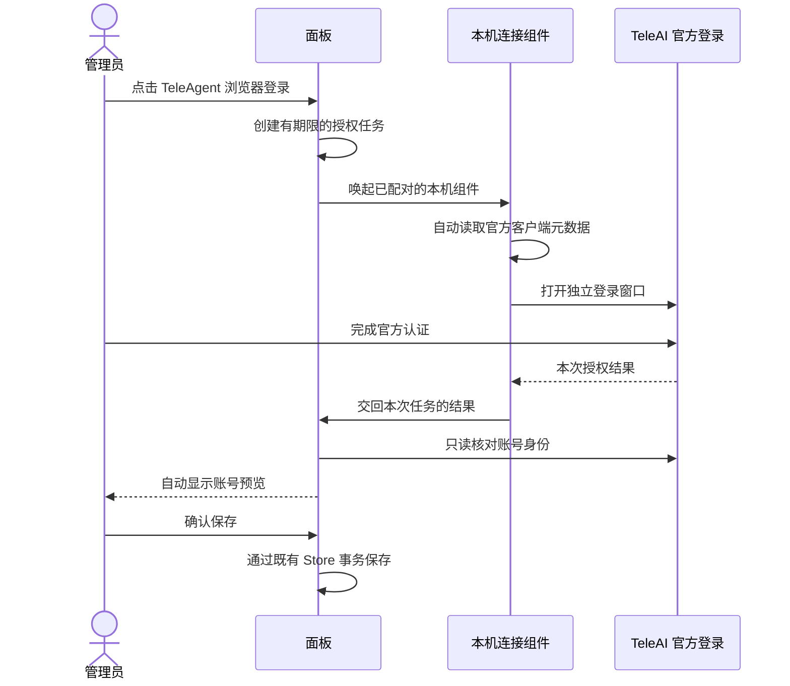

# TeleAgent 登录交互收敛设计

状态：自动交接已实现，2026-11-05。真实 TeleAgent 认证和 Windows 桌面启动仍待验收。

## 目标

日常操作与 WorkBuddy 对齐：添加账号 → 选择 TeleAgent → 点击浏览器登录 → 在官方页面授权 → 面板显示账号预览 → 确认保存。

首次使用时安装并连接本机登录组件；连接完成后的每次登录，不下载任务文件、不运行终端命令、不选择结果 JSON、不手工填写设备信息。客户端缺失、连接组件未运行或账号授权失败，都在面板给出对应动作。

v0.3.14 本地包只实现元数据自动读取和文件交接。后续实现使用本机 loopback 组件、Origin/连接密钥配对和页面自动轮询，日常不再需要文件交接；首次仍需要安装 Node 和执行一次安装命令。原生独立可执行安装包仍是后续范围。

## 已确认的协议差异

- WorkBuddy 在 `backend/internal/workbuddy/client.go` 的 `BeginLogin` 中请求官方 `/v2/plugin/auth/state`，取得授权 URL 和 state；`CheckLogin` 请求 `/v2/plugin/auth/token?state=…` 检查结果，再核对账号。凭据可由面板服务器直接取得。
- TeleAgent 当前接入的 UPMS 授权回到官方 `cowork/auth`，再通过桌面深链交付账号令牌。现有助手使用独立浏览器接收本次授权，面板不支持将官方回调替换为自己的地址。尚未核实与 WorkBuddy 等价的远程授权结果查询接口。
- TeleAgent 网关元数据可从用户本机安装的官方客户端及设备级 `device-meta.json` 只读取得。本机 3.0.0-rc.4 已验证这一步；新账号令牌仍由官方登录产生。

参考：[固定版本的登录实现](https://github.com/anye-99/dsh-codearts-auth/blob/686658793c982cd0e1baedbcfa10a396ce5d1a09/src/teleagent-cdp-login.ts)。该参考不能证明当前官方服务支持任意回调或公开设备码授权；后续取得官方轮询协议证据时，可替换底层适配，保留同一交互。

## 产品流程

首次使用：面板检测连接组件 → 未安装则显示对应系统下载与安装入口 → 组件显示待连接的面板地址 → 用户确认该面板 → 返回面板完成配对。

日常登录：

浏览器唤起本机组件可能需要用户确认“打开应用”。该确认如实呈现，不把未成功唤起显示为“正在授权”。组件未就绪时停留在连接提示，不跳到配置 JSON 表单。

## 职责与边界

### 面板

- 继续使用统一管理员认证与现有分阶段账号登录服务。普通用户没有发起、查看或确认平台账号授权的权限。
- 页面自动查询本次任务的等待、授权中、核验中、预览、失败、取消、过期状态；关闭或取消后，迟到结果不能保存。
- 自动接收结果只生成预览。账号保存、重复账号覆盖和删除后的失效语义继续由现有服务和 Store 控制。
- 文件导入保留在高级操作中，不再占据浏览器登录主流程。

### 本机连接组件

- 在用户电脑运行；远程 Linux 服务不能替用户启动本地浏览器。连接组件以桌面用户权限运行，首次安装后由页面唤起。
- 复用已验证的元数据读取与独立浏览器授权捕获；只读取 TeleAgent 固定资源和设备信息，不读取旧账号 Token、其他浏览器配置或系统钥匙串。
- 当前为随面板嵌入分发的独立 Node 脚本，首次安装后后台运行并随桌面自启动；日常无需终端操作。Linux / Windows 提供自启动安装，macOS 使用前台服务。原生独立安装包与 Windows/macOS 真实桌面验收仍待完成。
- 不将授权令牌或网关密钥放入唤起 URL、命令行参数、剪贴板或普通日志。正常流程的授权结果只在内存交接，交接后清理本次浏览器与任务状态。

### 任务交接

- 首次配对必须明确显示并绑定面板 origin。只允许 HTTPS，或本机 loopback HTTP。其他网站不能通过唤起链接把账号凭据发送到它指定的地址。
- 唤起信息仅包含有界任务标识；实际任务及结果使用配对连接与一次性权限交接，不能把管理员登录 Cookie 或长期管理密钥交给组件。
- 如服务器需要接收组件结果，接收能力必须绑定管理员会话、具体任务、平台、短期限和一次使用。它只允许交回本次结果，不提供读取账号、修改角色、创建用户或确认保存权限。
- 管理员退出、任务取消或超时后，交接权限失效；失败重试不得跨任务或替换已核对的账号。结果大小、并发及总等待期限沿用现有限制。
- 凭据交接前，组件再次确认任务属于已配对面板；面板再向官方核验稳定账号身份。任何一步失败都不写账号池。

## 验收标准

1. 首次安装配对完成后，新增第二个账号全程不使用终端、任务文件、结果文件或手填凭据。
2. 本地面板和远程 HTTPS 面板均完成相同流程；组件始终在用户桌面运行。
3. 用户官方登录完成后，面板自动显示正确账号预览；未点击确认之前账号池不变。
4. 错误 origin、过期/重放任务、普通用户、管理员退出和取消后的迟到结果均被拒绝。
5. 自动元数据读取失败、浏览器关闭、网络中断、组件退出、重复账号冲突都有明确反馈及可重试动作。
6. Linux / Windows 发布产物实测安装、唤起、配对、升级、卸载；授权结果不残留在任务文件、命令行或日志中。
7. 使用真实 TeleAgent 账号完成一次官方登录、身份核验及用户明确授权的最小调用后，才标记真实链路通过。模拟和页面测试只作为此前的回归证据。

## 实施顺序

配对与任务交接、后台组件、页面自动预览均已接通，真实 loopback + 生产页面模拟回归验证日常零文件交接。新账号真实官方认证、远程 HTTPS 浏览器网络权限以及 Windows/macOS 桌面行为尚待实际验收，不将模拟结果写成真实上游已通过。
